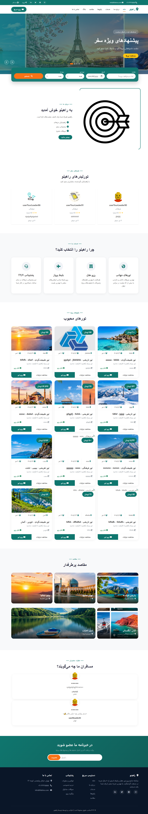

# Rahino-Portfolio
Rahino — Full-Stack Tourism Platform | Project Showcase
# Rahino — Full-Stack Tourism Platform

**Rahino** is a full-stack tourism web application designed to make travel planning and tour management easier. The platform brings travelers, tour leaders, and administrators together in one place, providing a foundation for managing tours, bookings, and travel-related services.

This project was developed as a full-stack web development project, with a focus on backend API development, frontend integration, user authentication, and tourism-related business logic.

## 🌍 Project Overview

Rahino aims to provide a convenient experience for travelers while offering management tools for the people responsible for organizing and operating tours.

The application is designed to support different user roles and tourism services through a structured web application.

## ✨ Key Features

- **Tour Management:** Create, display, and manage tour information.
- **User Authentication:** Support user registration, login, and role-based access.
- **Booking Management:** Organize and manage tour reservations.
- **Tour Leader Management:** Provide functionality for managing tour leaders and displaying relevant information.
- **Ratings and Reviews:** Support feedback and ratings for tours and tour leaders.
- **Custom Tour Requests:** Allow users to submit personalized travel requests.
- **Travel Services:** Include modules for tourism-related services such as hotels, transportation, tickets, and travel insurance.
- **User Dashboard:** Provide a dedicated area for users to access relevant account features.
- **Administrative Dashboard:** Support administrative management of the platform.
- **Responsive Frontend:** Organize the interface into pages for accessing the platform's features.

*Note: Feature availability may vary depending on the current implementation and configuration of the application.*

## 🛠️ Technologies Used

### Backend
- Node.js
- Express.js
- Sequelize ORM
- PostgreSQL
- JSON Web Tokens (JWT)
- bcryptjs
- express-validator

### Frontend
- HTML
- CSS
- JavaScript

## 🏗️ Project Architecture

The application separates frontend pages from backend services to make the codebase easier to maintain and extend.

- **Frontend:** User-facing pages and interface components.
- **Backend:** API endpoints, application logic, and request handling.
- **Database:** PostgreSQL with Sequelize models for managing application data.
- **Authentication and Authorization:** Token-based authentication and access control for different user roles.

## 🎯 Project Goals

The main goals of Rahino are to:

- Build a practical full-stack tourism application.
- Connect frontend interfaces to backend APIs.
- Organize tourism-related data and workflows.
- Implement authentication and role-based access.
- Create a foundation that can be extended with additional travel features.

## 🚀 Future Improvements

Potential improvements include:

- Enhanced search and filtering for tours.
- Improved booking and reservation workflows.
- More advanced user profiles and image management.
- Enhanced administrative tools.
- Better testing, security, and performance.
- Additional integrations with external travel services.

## 👨‍💻 Developer

**Full-Stack Web Developer**

This project demonstrates practical experience in web application development, REST API design, database integration, authentication, and frontend-backend communication.

---

# راهینو — پلتفرم گردشگری فول‌استک

**راهینو (Rahino)** یک اپلیکیشن وب گردشگری فول‌استک است که با هدف ساده‌تر کردن برنامه‌ریزی سفر و مدیریت تورها طراحی شده است. این پلتفرم بستری برای ارتباط مسافران، تورلیدرها و مدیران فراهم می‌کند و امکاناتی برای مدیریت تورها، رزروها و خدمات مرتبط با سفر در نظر گرفته است.

این پروژه با تمرکز بر توسعه بک‌اند، طراحی API، اتصال فرانت‌اند به بک‌اند، احراز هویت کاربران و پیاده‌سازی منطق تجاری مرتبط با گردشگری توسعه داده شده است.

## 🌍 معرفی پروژه

هدف راهینو فراهم کردن تجربه‌ای آسان‌تر برای مسافران و ارائه ابزارهای مدیریتی به افرادی است که مسئول سازمان‌دهی و اجرای تورها هستند.

ساختار برنامه به‌گونه‌ای طراحی شده است که از نقش‌های کاربری و خدمات مختلف گردشگری پشتیبانی کند.

## ✨ قابلیت‌های اصلی

- **مدیریت تورها:** ایجاد، نمایش و مدیریت اطلاعات تورها.
- **احراز هویت کاربران:** پشتیبانی از ثبت‌نام، ورود و دسترسی مبتنی بر نقش کاربر.
- **مدیریت رزروها:** سازمان‌دهی و مدیریت رزرو تورها.
- **مدیریت تورلیدرها:** فراهم کردن امکانات مدیریت تورلیدرها و نمایش اطلاعات مرتبط.
- **امتیازدهی و نظرات:** پشتیبانی از ثبت بازخورد و امتیاز برای تورها و تورلیدرها.
- **درخواست تور اختصاصی:** امکان ثبت درخواست سفر متناسب با نیاز کاربر.
- **خدمات گردشگری:** در نظر گرفتن بخش‌هایی برای خدماتی مانند هتل، حمل‌ونقل، بلیت و بیمه مسافرتی.
- **پنل کاربری:** فراهم کردن محیطی اختصاصی برای دسترسی کاربران به امکانات حساب خود.
- **پنل مدیریت:** پشتیبانی از مدیریت بخش‌های مختلف پلتفرم.
- **رابط کاربری واکنش‌گرا:** سازمان‌دهی صفحات رابط کاربری برای دسترسی به قابلیت‌های برنامه.

*توجه: در دسترس بودن هر قابلیت به وضعیت پیاده‌سازی و تنظیمات فعلی برنامه بستگی دارد.*

## 🛠️ فناوری‌های استفاده‌شده

### بک‌اند
- Node.js
- Express.js
- Sequelize ORM
- PostgreSQL
- JSON Web Tokens (JWT)
- bcryptjs
- express-validator

### فرانت‌اند
- HTML
- CSS
- JavaScript

## 🏗️ معماری پروژه

در این پروژه، صفحات فرانت‌اند از سرویس‌های بک‌اند جدا شده‌اند تا نگهداری و توسعه کدها آسان‌تر باشد.

- **فرانت‌اند:** صفحات و اجزای رابط کاربری.
- **بک‌اند:** مسیرهای API، منطق برنامه و پردازش درخواست‌ها.
- **پایگاه داده:** استفاده از PostgreSQL و مدل‌های Sequelize برای مدیریت اطلاعات برنامه.
- **احراز هویت و مجوزها:** احراز هویت مبتنی بر توکن و کنترل دسترسی بر اساس نقش‌های کاربران.

## 🎯 اهداف پروژه

اهداف اصلی راهینو عبارت‌اند از:

- توسعه یک اپلیکیشن کاربردی و فول‌استک در حوزه گردشگری.
- اتصال رابط کاربری به APIهای بک‌اند.
- سازمان‌دهی اطلاعات و فرایندهای مرتبط با گردشگری.
- پیاده‌سازی احراز هویت و دسترسی مبتنی بر نقش.
- ایجاد بستری برای توسعه قابلیت‌های بیشتر در آینده.

## 🚀 توسعه‌های آینده

برخی از قابلیت‌هایی که می‌توان در آینده به پروژه اضافه یا در آن بهبود داد:

- جست‌وجو و فیلتر پیشرفته تورها.
- بهبود فرایند رزرو و مدیریت درخواست‌ها.
- توسعه پروفایل کاربران و مدیریت تصاویر.
- گسترش ابزارهای پنل مدیریت.
- بهبود آزمون‌ها، امنیت و عملکرد برنامه.
- اتصال به سرویس‌های گردشگری خارجی.

## 👨‍💻 توسعه‌دهنده

**برنامه‌نویس فول‌استک وب**

این پروژه تجربه عملی در زمینه توسعه اپلیکیشن‌های وب، طراحی REST API، اتصال به پایگاه داده، احراز هویت و ارتباط بین فرانت‌اند و بک‌اند را نشان می‌دهد.

📸 Project Screenshots

  Home Page :

